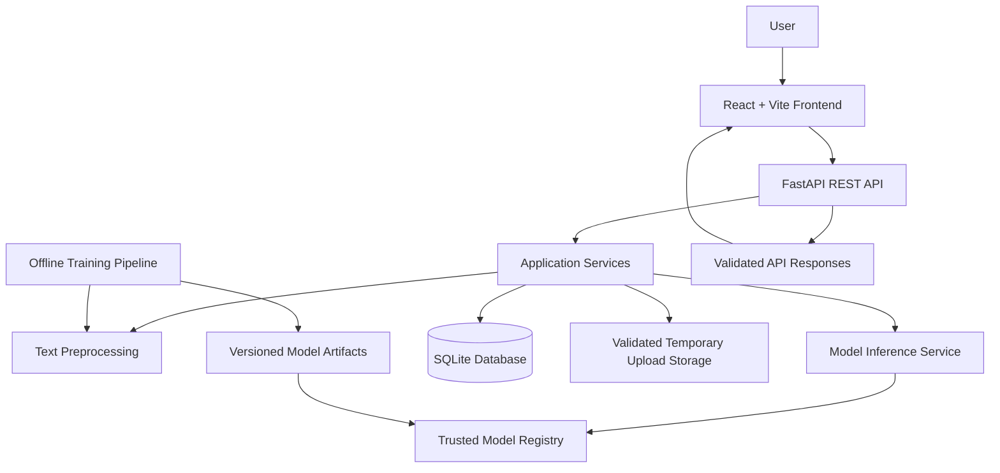

# SentiScope AI — System Architecture

## 1. Architecture principles

SentiScope AI is a clean-slate application. Its architecture is designed specifically for this project and must not be derived from, migrated from, or coupled to any existing repository, ZIP, or legacy codebase.

Principles:
- Separation of concerns.
- API-first frontend/backend communication.
- Reproducible ML training and inference.
- Explicit data validation.
- Testable modules.
- Minimal operational complexity for an academic project.
- Secure defaults and honest analytics.

## 2. High-level architecture



## 3. Technology stack

### Frontend
- React + Vite
- JavaScript/JSX
- Tailwind CSS
- React Router
- TanStack Query
- Recharts
- Framer Motion
- Lucide React

### Backend
- Python 3.11+
- FastAPI
- Pydantic
- SQLAlchemy
- SQLite

### ML
- scikit-learn baseline: TF-IDF + Logistic Regression
- TensorFlow/Keras LSTM as an advanced model when feasible
- pandas and NumPy for dataset handling
- NLTK only for preprocessing tasks that are justified and reproducible

### Quality
- Pytest
- Vitest
- React Testing Library
- Ruff/Black or a consistent Python formatter/linter
- ESLint/Prettier for frontend

## 4. Repository structure

```text
SentiScope-AI/
├── frontend/
│   ├── index.html
│   ├── package.json
│   ├── vite.config.js
│   └── src/
│       ├── app/
│       ├── assets/
│       ├── components/
│       ├── features/
│       │   ├── dashboard/
│       │   ├── text-analysis/
│       │   ├── dataset-analysis/
│       │   ├── analytics/
│       │   ├── model-performance/
│       │   ├── model-registry/
│       │   ├── history/
│       │   ├── reports/
│       │   └── settings/
│       ├── layouts/
│       ├── lib/
│       ├── services/
│       ├── styles/
│       └── main.jsx
├── backend/
│   ├── app/
│   │   ├── api/
│   │   │   └── v1/
│   │   │       └── routers/
│   │   ├── core/
│   │   ├── db/
│   │   ├── models/
│   │   ├── schemas/
│   │   ├── services/
│   │   ├── ml/
│   │   └── main.py
│   ├── tests/
│   └── requirements.txt
├── ml/
│   ├── data/
│   ├── notebooks/
│   ├── scripts/
│   ├── src/
│   ├── configs/
│   └── README.md
├── artifacts/
│   └── .gitkeep
├── data/
│   └── .gitkeep
├── docs/
├── .env.example
├── .gitignore
└── README.md
```

This is a proposed structure. Keep it understandable; do not create empty folders or abstractions without a purpose.

## 5. Backend layers

### API routers
Handle HTTP routing, authentication only if later introduced, request/response schemas, and status codes. Routers must remain thin.

### Schemas
Pydantic request and response models. Validate lengths, types, pagination, and supported labels.

### Services
Contain application use cases:
- Single prediction.
- Batch prediction.
- CSV analysis.
- Analytics aggregation.
- Model metadata and evaluation retrieval.
- History and export.

### ML package
Contains:
- Preprocessing.
- Training.
- Evaluation.
- Inference adapters.
- Model registry/loading.
- Label mapping and model metadata.

Do not mix model training code into HTTP route handlers.

### Database
SQLAlchemy models and session management. Store metadata and optional history. Avoid raw text persistence by default.

## 6. Frontend architecture

Use feature-based organisation. Each feature may contain its own page, components, hooks, schemas, and API functions.

Shared components belong in `components/`; shared layouts in `layouts/`; HTTP client and query configuration in `lib/` or `services/`.

The frontend must not contain ML model files, Python code, or secrets. It calls the backend through a single configured API base URL.

## 7. API contract

Prefix: `/api/v1`

Initial endpoints:

| Method | Endpoint | Purpose |
|---|---|---|
| GET | `/health` | Service health |
| POST | `/analysis/predict` | Single-text prediction |
| POST | `/analysis/batch` | Batch text prediction |
| POST | `/datasets/analyze` | Validated CSV analysis |
| GET | `/analytics/overview` | Actual aggregate analytics |
| GET | `/models` | Available model metadata |
| GET | `/models/{model_id}/metrics` | Evaluation metrics |
| GET | `/history` | Paginated history, if enabled |
| DELETE | `/history/{record_id}` | Delete a stored history record |
| GET | `/reports/{report_id}/export` | Export a generated report/result |

Use consistent response envelopes and documented error schemas. Do not expose server paths, stack traces, or internal exception details.

## 8. ML lifecycle

### Training
1. Acquire a documented, permitted dataset.
2. Validate schema and labels.
3. Remove or handle invalid rows transparently.
4. Split into train, validation, and test sets with a fixed seed.
5. Fit preprocessing only on training data.
6. Train baseline model.
7. Evaluate on held-out test set.
8. Save trusted artifacts and metadata.
9. Register model version.

### Inference
1. Validate incoming text.
2. Load an approved model from the registry.
3. Apply the exact preprocessing pipeline used during training.
4. Predict one of the supported labels.
5. Return prediction and model metadata.
6. Return probability scores only if the model supports them and their meaning is documented.

### Artifact safety
Only load model artifacts generated by the trusted training pipeline. Do not load arbitrary user-uploaded pickle/joblib files. Keep artifact paths fixed/configured on the server.

## 9. Data model (initial proposal)

- `AnalysisRecord`: id, created_at, predicted_label, model_id, optional source_type, optional dataset_id. Raw text is excluded by default.
- `DatasetRecord`: id, filename_safe_display, row_count, created_at, selected_text_column, processing_status, summary metadata.
- `ModelRecord`: id, name, version, model_type, trained_at, label_set, artifact_reference, evaluation_summary.
- `ReportRecord`: id, created_at, report_type, file_reference, status.

Persist only fields required for product behaviour. Revisit schema after implementation needs are clear.

## 10. Configuration and environment

- Use environment variables for backend configuration.
- Provide `.env.example` with safe placeholders.
- Never expose server secrets through Vite `VITE_*` variables.
- Configure CORS for explicit development and deployment origins.
- Keep local database and model artifacts out of version control unless explicitly required.

## 11. Deployment model

Initial target: local development and demonstrable academic deployment.

Frontend and backend may be deployed separately. Choose hosting only after verifying Python runtime, model artifact size, memory, request limits, and persistence requirements. Do not claim a deployment target is compatible without testing it.

## 12. Architecture acceptance checks

- Frontend can call backend health endpoint.
- API schemas validate requests and responses.
- ML inference is isolated from route handlers.
- Training and evaluation are reproducible.
- Uploaded files are validated before processing.
- Database operations are isolated behind services/repositories.
- No legacy code or archive is required to build or run the application.
