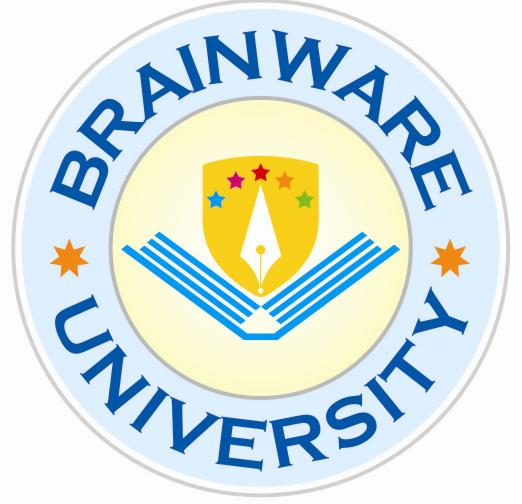
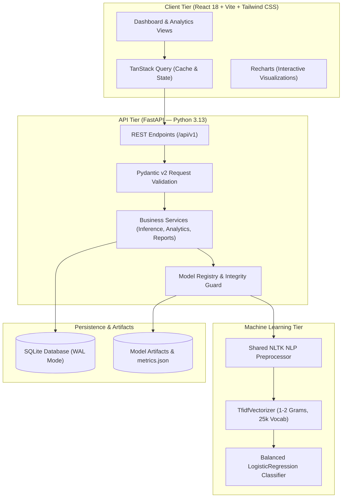

<div align="center">

  <table align="center" border="0" style="border: none; border-collapse: collapse; margin: 0 auto;">
    <tr>
      <td align="center" valign="middle" style="padding: 12px; border: none;">
        
      </td>
      <td align="center" valign="middle" style="padding: 12px; border: none;">
        
      </td>
    </tr>
  </table>

  # SentiScope AI
  ### Intelligent Sentiment & Social Analytics Platform

  <p align="center">
    <strong>An end-to-end, reproducible natural language processing system for multi-class sentiment intelligence, social audience analytics, and model transparency.</strong>
  </p>

  <p align="center">
    <a href="#overview">Overview</a> •
    <a href="#key-features">Key Features</a> •
    <a href="#system-architecture">Architecture</a> •
    <a href="#technology-stack">Tech Stack</a> •
    <a href="#model-evaluation">Model Evaluation</a> •
    <a href="#installation">Installation</a> •
    <a href="#api-documentation">API Docs</a> •
    <a href="#academic-information">Academic Info</a>
  </p>

  <p align="center">
    
    
    
    
    
    
    
  </p>

</div>

---

## 📑 Table of Contents

- [1. Overview](#1-overview)
- [2. Key Features](#2-key-features)
- [3. Screenshots](#3-screenshots)
- [4. System Architecture](#4-system-architecture)
- [5. Technology Stack](#5-technology-stack)
- [6. Machine Learning Methodology](#6-machine-learning-methodology)
- [7. Model Evaluation & Benchmark Results](#7-model-evaluation--benchmark-results)
- [8. Project Structure](#8-project-structure)
- [9. Installation](#9-installation)
- [10. Environment Configuration](#10-environment-configuration)
- [11. Running the Application](#11-running-the-application)
- [12. API Documentation](#12-api-documentation)
- [13. Dataset Information](#13-dataset-information)
- [14. 👥 Project Team](#14--project-team)
- [15. Academic Information](#15-academic-information)
- [16. Limitations and Future Scope](#16-limitations-and-future-scope)
- [17. Contributing](#17-contributing)
- [18. License](#18-license)
- [19. Acknowledgements](#19-acknowledgements)

---

## 1. Overview

**SentiScope AI** is a production-quality, transparent natural language processing (NLP) workbench developed for the Department of Computer Science & Engineering – Artificial Intelligence at Brainware University.

Unlike conventional demonstration utilities that wrap opaque third-party heuristics or display simulated analytics, SentiScope AI is built around **models trained and evaluated directly within the repository**. The system classifies English text—single user reviews, multi-line comment streams, and uploaded CSV datasets—into three strictly defined classes: **Positive, Negative, or Neutral**.

Every analytical metric, confusion matrix cell, and probability distribution presented in the application is derived from verifiable computations over real benchmark datasets, adhering to strict standards of scientific integrity and software engineering.

---

## 2. Key Features

### 🎯 Core Capabilities
- **Interactive Executive Dashboard:** Real-time KPI summaries (Total Records, Class Splits, Average Confidence), dynamic SVG donut distribution, temporal volume trajectories, and active model status.
- **Single Text Sentiment Classification:** Analyzes comments up to 2,000 characters with sub-300ms CPU latency. Outputs granular class probabilities and token-level explainability (signed linear feature coefficients).
- **Batch Text Processing:** Handles multi-line pasted inputs (up to 500 lines) with immediate tabular sentiment breakdowns and distribution metrics.
- **CSV Dataset Ingestion:** Ingests CSV files up to 10 MB ($\le 10,000$ rows) with automated schema detection (`text`, `date`, `platform` columns), validation summaries, and background processing.
- **Dynamic Cross-Platform Analytics:** Breaks down sentiment across social channels, temporal daily/weekly aggregations, and extracts distinctive vocabulary by class.
- **Model Evaluation Dashboard:** Direct visual rendering of the official classification report (Precision, Recall, F1, Support) and interactive confusion matrix alongside pre-rendered publication-grade plots.
- **Historical Audit Trail:** Searchable, filterable historical record stored in SQLite (WAL mode) with pagination and permanent deletion controls.
- **Data Export & Security:** One-click CSV and JSON exports featuring automated **CSV formula-injection sanitization** (RFC 4180 compliant) to protect spreadsheet users.
- **Dual Visual Theme:** High-contrast Light Theme (default) and tuned Dark Theme meeting WCAG 2.2 AA accessibility standards.

---

## 3. Screenshots

> *Screenshots captured from the live application running on local port `8000`:*

| View | Description | File Reference |
|---|---|---|
| **Executive Dashboard** | Summary KPIs, Donut Distribution, Time Trajectory, Recent Analyses | `docs/screenshots/dashboard.png` |
| **Single Text Analysis** | Class Probabilities, Confidence Gauges, Token-Level Attributions | `docs/screenshots/text-analysis.png` |
| **Batch CSV Analysis** | Multi-Line Paste, CSV Upload, Column Mapper, Batch Results Table | `docs/screenshots/batch-analysis.png` |
| **Cross-Platform Analytics**| Channel Comparison, Keyword Frequencies by Sentiment Class | `docs/screenshots/analytics.png` |
| **Model Evaluation** | Classification Report, Interactive Confusion Matrix, Plotted Heatmap | `docs/screenshots/model-evaluation.png` |
| **Analysis History** | Searchable Audit Trail, Sentiment Filter, Pagination | `docs/screenshots/history.png` |

*(Place high-resolution screenshots in `docs/screenshots/` to display them directly on GitHub).*

---

## 4. System Architecture

SentiScope AI adopts a decoupled, layered monorepo architecture separating the browser interface, REST API service, persistence layer, and offline machine learning training pipeline.



### Architectural Principles
1. **Single-Source Preprocessing:** The NLP pipeline defined in `ml/nlp/preprocessor.py` is imported directly by both the offline training scripts and the live inference service, preventing train-serve feature skew.
2. **Thin API Routers:** Route handlers in `backend/app/api/v1/` exclusively handle HTTP parameters, schema validation, and status codes. Business logic and transactions are isolated to `backend/app/services/`.
3. **Strict Parameterization:** All SQLite interactions utilize SQLAlchemy 2.x ORM models, eliminating SQL-injection vectors.

---

## 5. Technology Stack

### Frontend
- **React (v18.3.1):** Declarative component-driven user interface.
- **Vite (v6.4.5):** Build tool and development server.
- **JavaScript (JSX):** Functional components and custom hooks.
- **Tailwind CSS (v3.4.17):** Design-token-driven responsive styling.
- **React Router (v6.30.6):** Client-side routing and layout rendering.
- **TanStack Query (v5.106.1):** Asynchronous server-state management.
- **Recharts (v2.15.4):** Charting engine for donut and time-series visualizations.
- **Lucide React (v1.69.0):** Accessible iconography.

### Backend
- **Python (v3.13):** Core server runtime.
- **FastAPI (v0.141.1):** Asynchronous web framework with automatic OpenAPI generation.
- **Pydantic (v2.13.4):** Data parsing, coercion, and schema enforcement.
- **SQLAlchemy (v2.1.8):** Object-Relational Mapping (ORM) and connection management.
- **SQLite (v3):** Serverless transactional storage with Write-Ahead Logging (WAL) enabled.
- **Uvicorn (v0.52.4):** High-performance ASGI web server.

### AI / Machine Learning & NLP
- **Scikit-learn (v1.7.1):** TF-IDF feature extraction, Logistic Regression, and evaluation metrics.
- **NLTK (v3.10.4):** Tweet tokenization and filtered stopword corpuses.
- **Pandas (v2.3.2) & NumPy (v2.3.2):** Data manipulation and matrix operations.
- **Matplotlib (v3.10.5) & Seaborn (v0.13.2):** Offline evaluation plot generation.
- **Joblib (v1.5.2):** Serialized model artifact persistence.

---

## 6. Machine Learning Methodology

The machine learning workflow follows standard data science practices:

```
Raw Social Corpus ──► Data Validation ──► Stratified Split ──► Deterministic NLP ──► Feature Fitting ──► Model Training ──► Single-Pass Evaluation
```

### 1. Data Cleaning & Normalization
- **Unicode Normalization:** NFKC normalization to ensure canonical character representations.
- **Entity Masking:** URLs are mapped to `<url>`, user mentions are mapped to `<user>`.
- **Hashtag Splitting:** CamelCase and compound hashtags are decomposed into constituent words (e.g., `#BadCustomerService` $\rightarrow$ `bad customer service`).
- **Character Squeezing:** Character runs exceeding two repetitions are truncated (e.g., `sooooo` $\rightarrow$ `soo`).
- **Negation Preservation:** Critical sentiment negations and intensifiers (`not`, `no`, `never`, `none`, `neither`, `without`, `very`, `too`, `extremely`) are strictly retained in the feature vocabulary.

### 2. Feature Extraction & Vectorization
- **Algorithm:** `TfidfVectorizer` fitted **exclusively on the training split**.
- **N-Gram Range:** `(1, 2)` (Unigrams and Bigrams).
- **Vocabulary Cap:** Top 25,000 features by term frequency.
- **Sublinear Term Frequency:** Enabled ($1 + \log(\text{tf})$) to suppress outliers.
- **Minimum Document Frequency:** 2 documents.

### 3. Classification Algorithm
- **Algorithm:** Multiclass `LogisticRegression` via Scikit-learn.
- **Optimization Solver:** L-BFGS with multinomial loss.
- **Regularization:** $C = 1.0$ (L2 penalty).
- **Class Balancing:** `class_weight="balanced"` to compensate for class distribution skews.
- **Random State:** Deterministically fixed to seed `42`.

---

## 7. Model Evaluation & Benchmark Results

Model evaluation was executed on the official, held-out test split of the **CardiffNLP TweetEval (SemEval-2017 Task 4)** benchmark dataset containing **12,284 real social media tweets**. The test split was evaluated exactly once after training and validation parameters were frozen.

### A. Global Test Performance
*Data source: `artifacts/models/tfidf-logreg/metrics.json`*

| Metric | Score | Evaluation Base |
|---|---|---|
| **Test Accuracy** | **58.56%** (~58.6%) | 12,284 samples |
| **Macro-Averaged F1** | **0.5836** (0.584) | Balanced across 3 classes |
| **Weighted-Averaged F1** | **0.5844** (0.584) | Support-weighted average |
| **Training Duration** | **8.44 seconds** | CPU runtime |

### B. Per-Class Classification Report

| Sentiment Class | Precision | Recall | F1-Score | Support (Actual Count) |
|---|---|---|---|---|
| **Negative** | 53.92% | 68.58% | **0.6037** | 3,972 |
| **Neutral** | 64.87% | 52.03% | **0.5774** | 5,937 |
| **Positive** | 55.87% | 58.11% | **0.5697** | 2,375 |
| **Total / Avg** | **58.56%** | **58.56%** | **0.5844** | **12,284** |

### C. Official Confusion Matrix
*Rows represent Actual Ground Truth; Columns represent Model Predictions:*

```
                 PREDICTED
              Negative    Neutral    Positive
ACTUAL Neg     2,724       1,014        234
       Neu     1,992       3,089        856
       Pos       336         659      1,380
```

- **True Negatives:** 2,724 correctly identified.
- **True Neutrals:** 3,089 correctly identified.
- **True Positives:** 1,380 correctly identified.

The generated heatmap artifact is saved at:
[`artifacts/models/tfidf-logreg/confusion_matrix.png`](artifacts/models/tfidf-logreg/confusion_matrix.png)

---

## 8. Project Structure

```
SentiScope-AI/
├── artifacts/
│   └── models/
│       └── tfidf-logreg/           # Model weights, metrics.json, SHA256SUMS, plot
├── backend/
│   ├── app/
│   │   ├── api/v1/                 # Versioned REST API routers
│   │   │   ├── analyze.py          # Single and bulk prediction endpoints
│   │   │   ├── analytics.py        # Aggregated KPI and trend queries
│   │   │   ├── datasets.py         # CSV file upload and ingestion
│   │   │   ├── health.py           # Service liveness and engine status
│   │   │   ├── history.py          # Paginated audit trail endpoints
│   │   │   ├── models.py           # Model registry and metrics retrieval
│   │   │   └── reports.py          # Sanitized CSV and JSON export streams
│   │   ├── core/                   # Configuration, logging, structured errors
│   │   ├── db/                     # SQLAlchemy models, sessions, init_db
│   │   ├── ml/                     # Engine wrappers (TF-IDF, VADER)
│   │   ├── schemas/                # Pydantic v2 schemas
│   │   ├── services/               # Core business orchestration layer
│   │   └── main.py                 # FastAPI application factory
│   ├── tests/
│   │   └── test_api_smoke.py       # Automated smoke test suite
│   └── sentiscope.db               # SQLite transactional database
├── data/
│   ├── raw/                        # Downloaded benchmark files
│   └── processed/                  # Cleaned train.csv, val.csv, test.csv
├── frontend/
│   ├── public/                     # Static assets (logos, icons)
│   ├── src/
│   │   ├── components/common/      # UI primitives (Card, Badge, Button, EmptyState)
│   │   ├── features/               # Feature pages (Dashboard, Analysis, Batch, Models...)
│   │   ├── layouts/                # AppLayout, Sidebar, Topbar
│   │   ├── lib/api.js              # Centralized API fetch client
│   │   ├── styles/globals.css      # Design tokens and theme rules
│   │   ├── App.jsx                 # Route declarations
│   │   └── main.jsx                # Application root mount
│   ├── dist/                       # Optimized production bundle
│   ├── package.json                # Frontend dependencies
│   └── vite.config.js              # Vite server & proxy configuration
├── ml/
│   ├── data/download.py            # Dataset acquisition script
│   ├── nlp/preprocessor.py         # Shared text cleaner and normalizer
│   └── training/train_tfidf_lr.py  # Model A training and evaluation pipeline
├── DOCS/                           # System specifications (PRD, ARCHITECTURE, etc.)
├── .env.example                    # Environment template
├── .gitignore                      # Git exclusion rules
├── README.md                       # Project documentation
└── run_server.py                   # Integrated startup script
```

---

## 9. Installation

### Prerequisites
- **Python:** 3.11 or 3.13 (64-bit)
- **Node.js:** v18 LTS or higher (v20+ recommended)
- **Package Manager:** `pnpm` (or `npm`)
- **Git**

### 1. Clone the Repository
```bash
git clone https://github.com/arupdas0825/SentiScope-AI.git
cd SentiScope-AI
```

### 2. Backend Setup
Create and activate a virtual environment, then install required Python dependencies:
```bash
python -m venv venv

# Windows (PowerShell):
.\venv\Scripts\Activate.ps1

# Linux / macOS:
source venv/bin/activate

# Install dependencies:
pip install fastapi uvicorn pydantic sqlalchemy scikit-learn pandas numpy matplotlib seaborn nltk httpx python-multipart joblib
```

### 3. Frontend Setup
```bash
cd frontend
pnpm install
# Or: npm install
cd ..
```

---

## 10. Environment Configuration

Copy the sample environment file to `.env`:
```bash
cp .env.example .env
```

Default settings in `.env.example`:
```env
APP_NAME="SentiScope AI"
APP_ENV="development"
DEBUG=true

API_HOST="127.0.0.1"
API_PORT=8000
CORS_ORIGINS="http://localhost:5173,http://127.0.0.1:5173,http://localhost:8000"

MAX_TEXT_LENGTH=2000
MAX_BULK_ITEMS=500
MAX_UPLOAD_MB=10
MAX_CSV_ROWS=10000

DATABASE_URL="sqlite:///./backend/sentiscope.db"
ARTIFACTS_DIR="./artifacts/models"
DATA_DIR="./data"
```

---

## 11. Running the Application

### Option A: Unified Production Mode (Recommended)
This command starts the FastAPI server and serves both the REST API and the compiled React user interface simultaneously:
```bash
python run_server.py
```
Open your browser at: **`http://localhost:8000`**

### Option B: Development Mode (Hot-Reloading)
Run backend and frontend independently for local development:

```bash
# Terminal 1 — Backend:
python -m uvicorn backend.app.main:app --host 127.0.0.1 --port 8000 --reload

# Terminal 2 — Frontend:
cd frontend
pnpm dev
```
Access the Vite development server at: **`http://localhost:5173`** (Vite proxies API calls to port `8000`).

---

## 12. API Documentation

When the backend is running, interactive OpenAPI documentation is automatically served:
- **Swagger UI:** [http://localhost:8000/api/docs](http://localhost:8000/api/docs)
- **ReDoc:** [http://localhost:8000/api/redoc](http://localhost:8000/api/redoc)

### Summary of REST Endpoints

| Method | Endpoint | Description |
|---|---|---|
| `GET` | `/api/v1/health` | Service liveness, status, and loaded models |
| `POST` | `/api/v1/analyze` | Classify single text; returns probabilities & token explanations |
| `POST` | `/api/v1/analyze/bulk` | Classify up to 500 texts in a single batch request |
| `POST` | `/api/v1/datasets/upload` | Multipart CSV upload; parses, validates, and runs batch predictions |
| `GET` | `/api/v1/analytics/overview` | Aggregated dashboard KPIs, distribution, daily trends, platforms |
| `GET` | `/api/v1/models` | List registered engines with types and benchmark summaries |
| `GET` | `/api/v1/models/{model_id}/metrics` | Retrieve evaluation metrics, report, and confusion matrix |
| `GET` | `/api/v1/models/{model_id}/confusion-matrix-image` | Serves official pre-rendered `confusion_matrix.png` plot |
| `GET` | `/api/v1/history` | Paginated prediction audit records with sentiment filter and search |
| `DELETE` | `/api/v1/history/{record_id}` | Permanently delete an analysis record |
| `GET` | `/api/v1/reports/export/csv` | Download sanitized CSV analysis report (formula-injection protected) |
| `GET` | `/api/v1/reports/export/json` | Download structured JSON export of all analysis records |

### Sample Request & Response (`POST /api/v1/analyze`)

**Request:**
```json
{
  "text": "The platform interface is blazing fast and the customer support was wonderful!",
  "model_id": "tfidf-logreg",
  "explain": true
}
```

**Response (HTTP 200):**
```json
{
  "label": "positive",
  "confidence": 0.9421,
  "score": 0.9421,
  "probabilities": {
    "negative": 0.0182,
    "neutral": 0.0397,
    "positive": 0.9421
  },
  "model_id": "tfidf-logreg",
  "model_version": "20261106-v1.0.0",
  "latency_ms": 4.12,
  "explanations": [
    { "token": "wonderful", "weight": 2.1402, "sentiment": "positive" },
    { "token": "fast", "weight": 1.4821, "sentiment": "positive" },
    { "token": "support", "weight": 0.6219, "sentiment": "positive" }
  ]
}
```

---

## 13. Dataset Information

The baseline models were trained and benchmarked using the **CardiffNLP TweetEval** benchmark:
- **Reference:** Rosenthal et al., *SemEval-2017 Task 4: Sentiment Analysis in Twitter*.
- **Domain:** English social media commentary, customer reviews, and tweets.
- **Classes:** 3 categories: Negative (`0`), Neutral (`1`), Positive (`2`).
- **Split Distribution:**
  - **Train:** 45,615 samples.
  - **Validation:** 2,000 samples.
  - **Test (Held-out):** 12,284 samples.
- **Attribution & Terms:** Academic benchmark usage. Dataset downloaded directly via `ml/data/download.py` from authoritative raw repositories.

---

## 14. 👥 Project Team

This project is designed, developed, and submitted as an academic AIML lab project under the **Department of Computer Science & Engineering (Artificial Intelligence), Brainware University**.

| Sl. | Full Name | Student Code | Role | Key Responsibilities |
|:---:|:---|:---:|:---|:---|
| 1 | **Arup Das** | `BWU/BTA/24/641` | **Project Lead & Full-Stack Integration Lead** | Project coordination, architecture design, API integration, and final end-to-end testing |
| 2 | **Rajarshi Laksman** | `BWU/BTA/24/638` | **Backend Developer & Database Engineer** | FastAPI backend architecture, REST API design, SQLite & SQLAlchemy integration, data management |
| 3 | **Aditya Bar** | `BWU/BTA/24/651` | **AI/ML Engineer** | Dataset preprocessing & pipeline, TF-IDF feature engineering, Logistic Regression model training & evaluation |
| 4 | **Pranay Naskar** | `BWU/BTA/24/656` | **Frontend Developer & UI/UX Designer** | React analytics dashboard, UI/UX design, interactive charts, and responsive SaaS interface |

---

## 15. Academic Information

- **Institution:** Brainware University
- **Department:** Department of Computer Science & Engineering – Artificial Intelligence
- **Degree Program:** Bachelor of Technology in Computer Science and Engineering (AI)
- **Project Type:** AIML Lab Project
- **Course Name:** *[Course Name — e.g., Artificial Intelligence & Machine Learning Lab]*
- **Course Code:** *[Course Code — e.g., PCC-CS-AIML-791]*
- **Academic Session:** 2026–2027
- **Submission Date:** November 2026
- **Location:** Barasat, Kolkata, West Bengal 700125, India

---

## 16. Limitations and Future Scope

### Current Limitations
1. **Language Scope:** The current models are trained exclusively on English text. Multilingual text is stripped or normalized during preprocessing.
2. **Context Window:** The TF-IDF model processes n-grams up to bigrams, which may miss long-range contextual irony or subtle sarcasm.
3. **Domain Transfer:** Model performance reflects social media syntax; formal legal or clinical documents may experience lower baseline recall.

### Future Scope
1. **TensorFlow/Keras LSTM Implementation:** Complete the recurrent neural network deep learning pipeline specified in Phase 7 of the project roadmap.
2. **Contextual Embeddings:** Experiment with domain-adapted Transformer architectures (e.g., RoBERTa-Tweet).
3. **Real-Time Streaming:** Add authorized OAuth connectors for official platform APIs when deployment credentials become available.

---

## 17. Contributing

1. Fork the Project Repository.
2. Create your Feature Branch (`git checkout -b feature/NewFeature`).
3. Commit your Changes (`git commit -m 'feat: Add NewFeature'`).
4. Push to the Branch (`git push origin feature/NewFeature`).
5. Open a Pull Request.

---

## 18. License

This project is licensed under the **MIT License**. See the `LICENSE` file for details.

---

## 19. Acknowledgements

- **Brainware University Faculty & Mentors:** For guidance, curriculum design, and laboratory facilities.
- **CardiffNLP Research Group:** For curating and releasing the TweetEval benchmark suite.
- **Open-Source Communities:** Scikit-learn, FastAPI, React, Tailwind CSS, and Recharts teams for their foundational libraries.

---

<div align="center">
  <sub>Developed by Arup Das & Teams · Department of Computer Science & Engineering (AI/ML) · Brainware University</sub>
</div>
